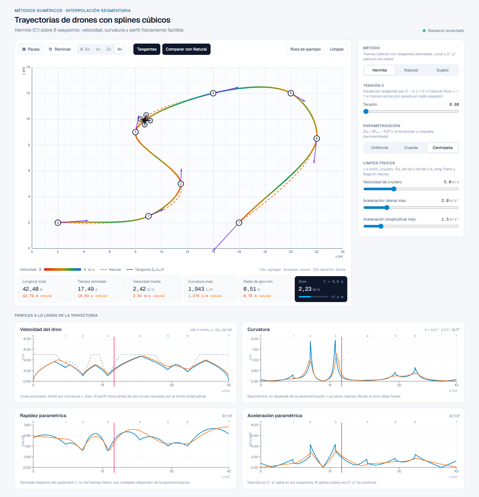
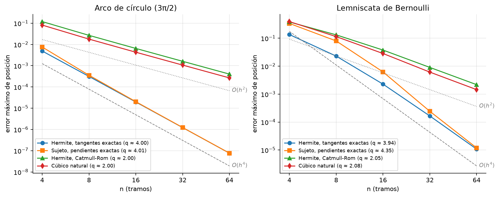

# Drone Splines: trayectorias de drones con splines cúbicos

Proyecto de **Métodos Numéricos** (Ingeniería de Software) sobre **interpolación segmentaria con splines de Hermite cúbicos**.

Un dron de reparto debe recorrer una lista de *waypoints* en un almacén sin detenerse en cada esquina. El simulador:

1. interpola una trayectoria suave p(t) = (x(t), y(t)) que pasa por todos los waypoints;
2. calcula su velocidad, aceleración y curvatura;
3. obtiene un **perfil de velocidad físicamente factible**: el dron frena antes de las curvas cerradas y acelera en las rectas.



## Qué incluye

| Parte | Contenido |
|---|---|
| `backend/core/` | Núcleo numérico en NumPy, **implementado a mano** (sin `scipy.interpolate`): parametrizaciones, tangentes cardinales/Catmull-Rom, spline de Hermite, spline cúbico natural y sujeto con el algoritmo de Thomas, curvatura, longitud de arco con Simpson, reparametrización con Newton + bisección, perfil de velocidad y estudio de convergencia. |
| `backend/api/` | API FastAPI: `POST /api/trajectory` y `GET /api/health`. Documentación automática en `/docs`. |
| `backend/tests/` | 94 tests con pytest. SciPy se usa **solo aquí**, para validar los resultados. |
| `frontend/` | Next.js + TypeScript + Tailwind. Plano interactivo en Canvas, dron animado y gráficas con Recharts. |
| `notebooks/analisis.ipynb` | Análisis para el informe: bases, Hermite vs natural, tensión, parametrización, convergencia y perfil de velocidad. |
| `docs/figuras/` | Figuras exportadas desde el notebook. |

## Cómo ejecutarlo

Requisitos: Python 3.11+ y Node.js 20+.

### Backend
```bash
cd backend
python -m venv .venv
# Windows (PowerShell): .venv\Scripts\Activate.ps1      Linux/macOS: source .venv/bin/activate
pip install -r requirements-dev.txt     # requirements.txt basta para solo ejecutar la API
uvicorn api.main:app --reload           # http://localhost:8000/docs
pytest -v                               # pytest tests/test_convergence.py -s muestra la tabla de errores
```

### Frontend
```bash
cd frontend
npm install
cp .env.local.example .env.local        # NEXT_PUBLIC_API_URL=http://localhost:8000
npm run dev                             # http://localhost:3000
```

### Notebook
```bash
cd notebooks
../backend/.venv/Scripts/python -m jupyter notebook analisis.ipynb   # Linux/macOS: ../backend/.venv/bin/python
```
El notebook importa `backend/core` directamente y guarda las figuras en `docs/figuras/`.

## Uso del simulador

- **Clic** en el plano: agregar un waypoint. **Arrastrar**: moverlo. **Clic derecho**: borrarlo.
- **Panel derecho**: método (Hermite, natural o sujeto), tensión `c`, parametrización y límites físicos.
- **Reproducir**: el dron recorre la curva a velocidad física; el marcador rojo de las gráficas sigue su posición.
- **Tangentes**: muestra las tangentes `mₖ` en cada nodo, escaladas como `Δₖ·mₖ/3`.
- **Comparar**: superpone el otro método. En la gráfica de aceleración se ve el salto C¹ de Hermite frente a la continuidad C² del natural.

## Método (resumen)

**Parametrización.** Se usa t₀ = 0 y tₖ₊₁ = tₖ + ‖Pₖ₊₁ − Pₖ‖^α, con α = 0 (uniforme), 1 (cuerda) o ½ (centrípeta).

**Hermite cúbico (C¹).** En el tramo k, con Δₖ = tₖ₊₁ − tₖ y u = (t − tₖ)/Δₖ:

```
p(u) = h00(u)·Pₖ + h10(u)·Δₖ·mₖ + h01(u)·Pₖ₊₁ + h11(u)·Δₖ·mₖ₊₁
h00 = 2u³ − 3u² + 1   h10 = u³ − 2u² + u   h01 = −2u³ + 3u²   h11 = u³ − u²
```

**Tangentes cardinales** con tensión c (c = 0 es Catmull-Rom). Con dₖ = (Pₖ₊₁ − Pₖ)/Δₖ:

```
mₖ = (1 − c)·(Δₖ·dₖ₋₁ + Δₖ₋₁·dₖ)/(Δₖ₋₁ + Δₖ)
```

En los extremos se usan diferencias unilaterales.

**Spline cúbico natural (C²).** Es un sistema tridiagonal diagonal dominante en las segundas derivadas Mₖ, resuelto con el algoritmo de Thomas en O(n).

**Cinemática.** La curvatura es κ = |x′y″ − y′x″| / ‖p′‖³. La longitud de arco s(t) = ∫‖p′‖ se calcula con Simpson compuesto.

**Perfil de velocidad.** El perfil cumple:

- límite por curvatura: v ≤ min(v_crucero, √(a_lat/κ));
- límite longitudinal: vᵢ² ≤ vᵢ₋₁² + 2·a_long·Δs, con pasada hacia adelante y hacia atrás; el dron parte y llega en reposo;
- tiempo total: T = Σ 2Δsᵢ/(vᵢ₋₁ + vᵢ).

### Resultados de convergencia

Error máximo de posición frente a curvas exactas; orden observado con n = 32 → 64:

| Método | Arco de círculo | Lemniscata |
|---|---|---|
| Hermite, tangentes exactas | 4.00 | 3.94 |
| Sujeto, pendientes exactas | 4.01 | 4.35 → 4 |
| Hermite, Catmull-Rom | 2.00 (interior 3) | 2.05 (interior 3) |
| Cúbico natural | 2.00 (interior 4) | 2.08 (interior 4) |

Con derivadas exactas se alcanza el orden teórico 4. Con derivadas estimadas, las **condiciones de frontera** reducen el orden global a 2.



## Despliegue

- **Backend en Render.** El archivo `render.yaml` define el servicio (raíz `backend/`, `uvicorn api.main:app --host 0.0.0.0 --port $PORT`). Hay que configurar `ALLOWED_ORIGINS` con el dominio de Vercel.
- **Frontend en Vercel.** El *Root Directory* es `frontend/` y la variable de entorno `NEXT_PUBLIC_API_URL` debe apuntar a la URL de Render.

## Estructura

```
backend/   core/ (núcleo numérico) · api/ (FastAPI) · tests/ (pytest)
frontend/  app/ · components/ · lib/
notebooks/ analisis.ipynb
docs/      figuras/
```

Las decisiones de diseño y las correcciones al plan original están en [PLAN.md](PLAN.md#8-decisiones-y-correcciones-al-plan).
